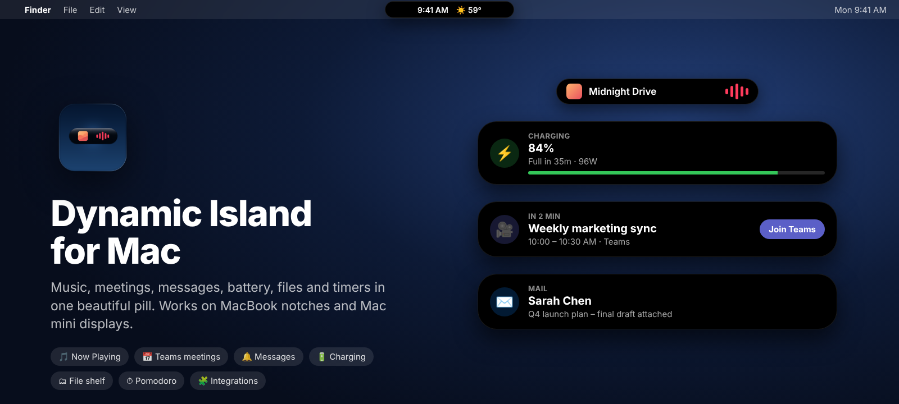

<p align="center">
  
</p>

<h1 align="center">Dynamic Island for Mac</h1>

<p align="center">
  
  
  
  
</p>

<p align="center">
  An iPhone-style Dynamic Island for <b>every Mac</b>.<br>
  On a MacBook it wraps around the notch. On a Mac mini, iMac, Mac Studio or external display it floats as a pill in the menu bar.
</p>

<p align="center">
  <a href="../../releases/latest"><b>⬇&nbsp;&nbsp;Download the latest version</b></a>&nbsp;&nbsp;·&nbsp;&nbsp;<a href="https://dynamicislandmac.com"><b>🌐&nbsp;dynamicislandmac.com</b></a>
</p>

---

## Contents

- [Features](#features)
- [Install](#install)
- [Using the island](#using-the-island)
- [Settings](#settings)
- [Permissions](#permissions)
- [Integrations](#integrations)
- [Troubleshooting](#troubleshooting)
- [Build from source](#build-from-source)
- [Releasing a new version](#releasing-a-new-version)
- [Project structure](#project-structure)
- [Privacy](#privacy)
- [Roadmap](#roadmap) · [Changelog](CHANGELOG.md) · [License](#license)

---

## Features

### Live in the pill
| | |
|---|---|
| 🎵 **Now Playing** | Apple Music, Spotify, and YouTube / YouTube Music in Chrome, Edge, Brave or Safari. Artwork and a live waveform. |
| 📅 **Next meeting** | Countdown to your next meeting. The island pops open 1 minute before it starts. |
| ⏱ **Timer / Pomodoro** | Live countdown while a timer is running. |
| 🔔 **Unread** | App icons with unread counts (Teams, Outlook, WhatsApp, Slack…). |
| 🎙 **Microphone** | An orange dot while any app is using your mic. |
| 🕐 **Idle** | Clock and local weather when nothing else is going on. |

### Banners that drop down
| | |
|---|---|
| 🔋 **Charging** (MacBook) | Plugged in / unplugged with %, time to full and adapter watts. Low battery at 20% and 10%, and fully charged. |
| 🍃 **Low Power Mode** · 🌡 **Overheating** | When they turn on |
| 💬 **New messages** | Teams, Outlook, WhatsApp, Messages, Slack, Telegram, Discord, Signal, Spark, Gmail app |
| ✉️ **New email** | Apple Mail shows the **sender and subject** |
| 🎧 **Bluetooth** | AirPods, headphones, keyboards and mice connecting or disconnecting, plus low battery |
| ⬇️ **Downloads** | When a download finishes |
| 🔊 **Volume** · ⇪ **Caps Lock** | A small HUD when they change |
| 🧩 **Your own** | Anything sent through the [integrations](#integrations) |

### Tabs in the open island
| Tab | What's inside |
|---|---|
| **Media** | Play/pause, next/previous, click the artwork to open the player |
| **Calendar** | Today's events with **Join** buttons for Teams, Zoom, Google Meet and Webex (Teams links open in the Teams app) |
| **Inbox** | Unread counts per app and your latest unread emails. Click to open. |
| **Shelf** | Drop files on the island to keep them handy, then drag them out, open them or **AirDrop** them. Also shows **clipboard history** and recent downloads. |
| **Timer** | Quick timers (1 minute to 1 hour) and a Pomodoro focus/break cycle |
| **System** | CPU, memory, disk, network speed, battery or uptime, and Bluetooth device batteries |
| **Shortcuts** | Run your Apple Shortcuts in one click (right-click to pin favourites) |
| **Search** | Apps, files, Google and YouTube, opened with **⌥ Space** |

The island also hides itself when a full-screen app (video, game, slides) is in front.

---

## Install

### Download (recommended)

1. Go to the [**latest release**](../../releases/latest) and download **DynamicIsland.dmg**.
2. Open it and drag **Dynamic Island** into **Applications**.
3. **First launch only:** right-click the app ▸ **Open** ▸ **Open**.
   On macOS 15 Sequoia and later, if there's no Open button, go to **System Settings ▸ Privacy & Security** and click **Open Anyway**.
   *(You need to do this because the app isn't notarized by Apple, which requires a paid developer account.)*
4. Allow the permissions it asks for. See [Permissions](#permissions).

**Requirements:** macOS 14 Sonoma or later. Runs on Apple silicon and Intel.

### Start automatically
Click the capsule icon in the menu bar ▸ **Launch at Login**.

### Update
Download the new `.dmg` and drag the app into Applications again, replacing the old one. After updating, you may need to switch **Accessibility** off and on again (see [Troubleshooting](#troubleshooting)).

### Uninstall
Quit it from the menu bar icon ▸ **Quit Dynamic Island**, then drag the app from Applications to the Trash.

---

## Using the island

| Do this | And this happens |
|---|---|
| Move the mouse over the pill | It opens (you can switch to click-to-open in Settings) |
| Move the mouse away, or click elsewhere | It closes |
| Press **⌥ Space** | Search opens. Use ↑↓ to choose, Return to open, Esc to close. |
| Drag a file onto the pill | It opens on the **Shelf** and keeps the file |
| Click a tab icon | Switches between Media, Calendar, Inbox, Shelf, Timer, System, Shortcuts, Search |
| Click the menu bar capsule icon | Version, Search, Start Focus, Refresh, **Settings…**, Launch at Login, Quit |

---

## Settings

Open **Settings…** from the capsule icon in the menu bar.

| Section | Options |
|---|---|
| **Look** | **Style:** floating pill or attached to the top edge. **Size:** Small, Medium, Large. *(MacBooks with a notch always wrap around the notch.)* |
| **General** | Launch at login, hover to open, follow the display the mouse is on, hide in full-screen apps, clock & weather when idle, sounds |
| **Tabs** | Show or hide each tab |
| **Mac alerts** | Charging & battery, volume HUD, Caps Lock HUD, microphone dot, Bluetooth devices, downloads, meeting pop-up |
| **Messages & email** | New-message banners, Apple Mail details, which apps to watch, Accessibility status |
| **Extras** | Clipboard history, weather, Pomodoro focus and break length |
| **Integrations** | Local web API on/off, copy-ready examples, test notification |
| **About** | Version number |

---

## Permissions

macOS asks the first time each feature needs a permission. Allow only the ones for features you want.

| Permission | Used for | If you said no by mistake |
|---|---|---|
| **Calendar** | Meetings and Join buttons | Privacy & Security ▸ Calendars |
| **Automation** (Music, Spotify, Chrome, Mail…) | Now Playing and email details | Privacy & Security ▸ Automation |
| **Accessibility** | Unread badges for messages | Inbox tab ▸ *Turn On*, or Privacy & Security ▸ Accessibility |
| **Bluetooth** | AirPods and keyboard banners | Privacy & Security ▸ Bluetooth |
| **Downloads folder** | "Download complete" banners | Privacy & Security ▸ Files and Folders |
| **Location** | Local weather | Privacy & Security ▸ Location Services |

### Teams and Outlook meetings
The island reads macOS Calendar. If your work meetings aren't there yet, go to **System Settings ▸ Internet Accounts ▸ Add Account ▸ Microsoft Exchange** and turn on **Calendars**.

### YouTube in your browser
To see play/pause state and control videos, allow the browser to be scripted:
- **Chrome / Edge / Brave:** **View ▸ Developer ▸ Allow JavaScript from Apple Events**
- **Safari:** Settings ▸ Advanced ▸ *Show features for web developers*, then **Develop ▸ Allow JavaScript from Apple Events**

### Why messages show counts and not text
macOS doesn't let apps read other apps' notifications. The island watches the red unread badges on **Dock icons** instead, so keep your messaging apps in the Dock. Apple Mail is the exception: it shows the sender and subject.

---

## Integrations

Anything that can open a URL or make an HTTP request can control the island: scripts, cron jobs, Apple Shortcuts, Raycast, Alfred, Home Assistant or AI coding agents.

### Commands

| Command | Parameters |
|---|---|
| `notify` | `title`, `body`, `subtitle`, `icon` (any [SF Symbol](https://developer.apple.com/sf-symbols/)), `color` (hex), `app` (bundle ID to use its icon), `sound` (`Glass`, `Ping`, `Hero`… or `none`), `duration` (seconds), `progress` (0–100), `id` (replace an earlier banner) |
| `timer` | `minutes=10`, `seconds=90`, `action=cancel\|pause\|pomodoro` |
| `open` | `tab=media\|calendar\|inbox\|shelf\|timer\|system\|shortcuts\|search` |
| `search` | `q=…` |
| `shelf` | `path=/full/path/to/file` |
| `shortcut` | `name=My Shortcut`, optional `input=…` |
| `media` | `action=toggle\|next\|previous` |
| `collapse` | — |

### 1. URL scheme
Works from Shortcuts ("Open URLs"), Raycast, Alfred, Keyboard Maestro, any app or Terminal:
```bash
open -g "dynamicisland://notify?title=Coffee&body=Ready%20in%20the%20kitchen&icon=cup.and.saucer.fill&color=a2845e"
open -g "dynamicisland://timer?minutes=10"
```

### 2. Local web API
Listens on **this Mac only** (`127.0.0.1:7787`). Accepts GET with query parameters or POST with JSON.
```bash
curl "http://127.0.0.1:7787/notify?title=Backup&body=Finished&icon=externaldrive.fill.badge.checkmark&color=34c759"
curl -X POST http://127.0.0.1:7787/notify -d '{"title":"Deploy","body":"v2.3 is live","icon":"paperplane.fill"}'
curl http://127.0.0.1:7787/ping
```

### 3. `island` command-line tool
```bash
sudo cp scripts/island /usr/local/bin/ && sudo chmod +x /usr/local/bin/island

island notify "Tests passed" "212 green" checkmark.seal.fill 34c759
island timer 25
island timer pomodoro
island open calendar
island shelf ~/Desktop/contract.pdf
island shortcut "Morning Routine"
island media next
```

### Recipes
- **Long Terminal commands:** `make build; island notify "Build finished" "exit code $?" hammer.fill`
- **AI coding agents** (Claude Code, Codex, Cursor…): add a "task finished" hook that runs `island notify "Agent finished" "Ready for review" sparkles`
- **Home Assistant:** a `rest_command` that calls `http://127.0.0.1:7787/notify` (run HA on the same Mac, or use an SSH `shell_command`). Good for doorbells, a finished washing machine, a garage left open…
- **cron / launchd:** `0 17 * * 1-5 /usr/local/bin/island notify "Time to wrap up" "" moon.stars.fill`
- **Shortcuts automation:** "When I arrive home → Open URL `dynamicisland://notify?title=Welcome%20home`"
- **Progress bars:** send `progress=40&id=render`, then `progress=80&id=render`. Banners with the same `id` replace each other.

---

## Troubleshooting

| Problem | Fix |
|---|---|
| "App can't be opened" on first launch | Right-click ▸ Open ▸ Open, or System Settings ▸ Privacy & Security ▸ **Open Anyway** |
| No banners for new messages | Turn on Accessibility. After an update, macOS sometimes keeps a stale entry: remove Dynamic Island from the Accessibility list with **–**, then add it again. Keep your messaging apps in the Dock. |
| YouTube shows the title but won't pause | Turn on *Allow JavaScript from Apple Events* in your browser |
| No meetings | Make sure they show up in the Calendar app (add your Exchange account) |
| No weather | Allow Location in Privacy & Security ▸ Location Services |
| Old icon still showing | Run `killall Dock; killall Finder` in Terminal, or restart |
| `curl` to port 7787 fails | Check Settings ▸ Integrations ▸ Local web API is on |
| Island is on the wrong display | Settings ▸ General ▸ *Show on the display the mouse is on* |

Still stuck? [Open an issue](../../issues/new/choose) with your macOS version and what you see.

---

## Build from source

You need the Xcode command-line tools: `xcode-select --install`

```bash
git clone https://github.com/naderbassily/Dynamic-Island-For-Mac.git
cd Dynamic-Island-For-Mac
./build.sh --install
```

Or, without Terminal, double-click these files in Finder:

| File | What it does |
|---|---|
| **Install Dynamic Island.command** | Builds the app, puts it in Applications and starts it. If the build fails, it saves `build-log.txt`. |
| **Make Shareable App.command** | Builds a universal **`Dynamic Island.dmg`** and **`.zip`** you can AirDrop, email or upload |

`build.sh` options: no option builds the app, `--install` builds and installs it, `--zip` makes a universal zip, `--share` makes a universal zip and dmg.

### Changing the icon
Replace `Resources/AppIcon.png` with a 1024 × 1024 PNG and rebuild. The build script creates every size macOS needs.

---

## Releasing a new version

1. Update the version in `Resources/Info.plist` (`CFBundleShortVersionString`) and the badge at the top of this README.
2. Add a section to [CHANGELOG.md](CHANGELOG.md), for example `## 2.2.0`.
3. Commit and push.
4. On GitHub, go to **Actions ▸ Release ▸ Run workflow**, enter the version (e.g. `2.2.0`) and click **Run**.
   Or push a tag: `git tag v2.2.0 && git push --tags`

GitHub builds the universal app and publishes a release with the **`.dmg`** and **`.zip`** attached. The release notes come from that version's CHANGELOG section.

Versions follow [Semantic Versioning](https://semver.org): **major**.**minor**.**patch**.

---

## Project structure

```
Sources/DynamicIsland/
  AppDelegate.swift          floating panel, notch & menu-bar placement, hover, hotkey, menu, full-screen hiding
  IslandViewModel.swift      state, sizes, banners, what the pill shows
  IslandView.swift           island shape, compact pill, banners, shared UI
  TabViews.swift             Media, Calendar, Inbox, Search tabs
  MoreTabs.swift             Shelf, Timer, System, Shortcuts tabs
  SettingsView.swift         Settings window
  Alerts.swift               banner model, notch detection, helpers
  NowPlayingService.swift    Music / Spotify / YouTube (AppleScript)
  CalendarService.swift      EventKit + meeting-link detection
  NotificationService.swift  Dock badges (Accessibility) + Apple Mail
  PowerService.swift         battery, charging, Low Power Mode, thermal (IOKit)
  AudioService.swift         volume HUD, microphone in use (CoreAudio)
  DeviceService.swift        Bluetooth connect/disconnect, peripheral battery
  ShelfService.swift         file shelf, downloads watcher, clipboard history
  TimerService.swift         timer and Pomodoro
  WeatherService.swift       Open-Meteo weather + CoreLocation
  SystemStatsService.swift   CPU, memory, disk, network
  Integrations.swift         Shortcuts, URL-scheme router, local HTTP API
  SearchService.swift        apps + Spotlight files + web
  Prefs.swift                settings storage
Resources/                   Info.plist, AppIcon.png
scripts/island               command-line helper
docs/                        README images
website/                     dynamicislandmac.com landing page (Vercel, root directory "website")
.github/workflows/           build on every push, release on demand
```

---

## Privacy

- Everything runs **on your Mac**. There are no accounts, analytics or tracking.
- The only network requests are artwork thumbnails (Spotify, YouTube) and weather from [Open-Meteo](https://open-meteo.com), which receives your approximate location rounded to about 100 m.
- Clipboard history stays in memory, is cleared when the app quits, and skips passwords from password managers.
- The local web API listens only on `127.0.0.1` (this Mac) and can be turned off.

---

## Roadmap

Screenshot shelf · Focus mode status · Reminders · stock and crypto tickers · per-app volume · themes · notarized builds

Ideas and pull requests are welcome. Please [open an issue](../../issues/new/choose).

## License

[MIT](LICENSE) © 2026 Nader Bassily

<sub>Not affiliated with Apple. "Dynamic Island" describes the style of the app. Apple, Mac, MacBook and AirPods are trademarks of Apple Inc.</sub>
